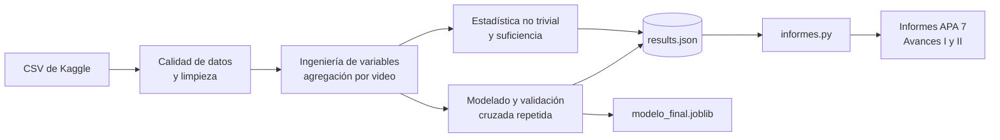

# 📊 Proyecto Estadísticas de YouTube

### Predicción del desempeño de un video a partir de sus comentarios (NLP + MLOps)


Repositorio de la tarea **«Proyecto Estadísticas de YouTube – Avances I y Avances II»** (informes de trabajo, semanas 7 y 8).
Contiene un *pipeline* reproducible que analiza la calidad de los datos, ejecuta análisis estadísticos no triviales, compara modelos de
aprendizaje automático y **genera automáticamente los informes en formato APA 7** a partir de los resultados.

---

## 👥 Datos del taller

| | |
|---|---|
| **Integrantes** | Julian Esteban Ballesteros Ortiz · Juan Diego Walteros Cortes |
| **Universidad** | Universidad de Cundinamarca |
| **Programa** | Inteligencia Artificial |
| **Asignatura** | CAD2202023206 – Procesamiento de Lenguaje Natural – EIAIIPA2026_2 |
| **Docente** | Paul Alexander Diaz Montaña |
| **Fecha** | domingo, 11 de octubre de 2026 |

---

## 📑 Tabla de contenido

1. [Contexto y objetivo](#-contexto-y-objetivo)
2. [Preguntas que responde el proyecto](#-preguntas-que-responde-el-proyecto)
3. [Estructura del repositorio](#-estructura-del-repositorio)
4. [Datos](#-datos)
5. [Metodología](#-metodología)
6. [Resultados de modelado](#-resultados-de-modelado)
7. [Instalación y uso](#-instalación-y-uso)
8. [Archivos generados](#-archivos-generados)
9. [Reproducibilidad y buenas prácticas](#-reproducibilidad-y-buenas-prácticas)
10. [Hoja de ruta MLOps](#-hoja-de-ruta-mlops)
11. [Limitaciones](#-limitaciones)
12. [Referencias principales](#-referencias-principales)

---

## 🎯 Contexto y objetivo

El objetivo es construir un modelo de **procesamiento de lenguaje natural (NLP)** que estime el desempeño de un video de YouTube
(vistas, *likes*) a partir de los **comentarios** de su audiencia, y que culmine como un modelo consumible por un usuario (interfaz y/o API),
siguiendo pautas de **MLOps**: manejo correcto de los datos, modelo en la nube y capacidad de monitoreo.

- **Semana 7 – Avances I:** énfasis en los **datos** (calidad, suficiencia, acceso, variables predictivas y análisis estadísticos no triviales).
- **Semana 8 – Avances II:** énfasis en el **modelo** (análisis estadísticos, modelo seleccionado, desempeño y métricas, herramientas,
  cantidad de modelos probados y selección de variables).

## ❓ Preguntas que responde el proyecto

| Informe | Pregunta guía | Dónde se responde |
|---|---|---|
| Avances I | ¿Cómo se accede a los datos y son suficientes? ¿Cómo mejorarlos? | Secciones *Acceso y descripción*, *Calidad* y *Suficiencia* |
| Avances I | ¿Qué variables podemos predecir (vistas, likes)? | *Identificación de variables y predicciones* |
| Avances I | ¿Qué análisis estadísticos no triviales podemos extraer? | *Análisis estadísticos no triviales* |
| Avances II | ¿Qué modelo se seleccionó, con qué desempeño y métricas? | *Resultados* y *Modelo seleccionado* |
| Avances II | ¿Cuántos modelos se probaron y con qué herramientas? | *Diseño experimental* y *Modelos evaluados* |
| Avances II | ¿Es suficiente un solo modelo? ¿Qué variables se usaron? | *¿Es suficiente un solo modelo?* e *Importancia de variables* |

## 🗂️ Estructura del repositorio

```text
.
├── data/                    # CSV de entrada (videos-stats.csv, comments.csv)
├── salida/                  # Resultados generados: results.json, figuras, modelo e informes
├── analisis.py              # Pipeline de análisis: calidad, estadística, modelos
├── informes.py              # Generador de informes APA 7 desde la plantilla + results.json
├── Plantilla_APA7.docx      # Plantilla de formato APA 7 (Times New Roman 12, interlineado doble)
├── requirements.txt         # Dependencias de Python
├── LEEME.md                 # Instrucciones breves de ejecución
└── README.md                # Este documento
```

## 🧾 Datos

Se utiliza el conjunto público **YouTube Statistics** de Kaggle ([advaypatil/youtube-statistics](https://www.kaggle.com/datasets/advaypatil/youtube-statistics)),
compuesto por dos archivos relacionados por `Video ID`:

| Archivo | Variables |
|---|---|
| `videos-stats.csv` | `Title`, `Video ID`, `Published At`, `Keyword`, `Likes`, `Comments`, `Views` |
| `comments.csv` | `Video ID`, `Comment`, `Likes`, `Sentiment` (0 = negativo, 1 = neutro, 2 = positivo) |

> **Nota:** respete la licencia y los términos de uso del conjunto en Kaggle. Los datos se tratan como de solo lectura y cada archivo
> queda registrado con su huella **SHA-256** en `results.json` para garantizar trazabilidad.

## 🧪 Metodología



### 1. Calidad de datos (Avances I)
Indicadores de **completitud, unicidad, validez, consistencia y cobertura** (marco de Wang & Strong, 1996), validación de la etiqueta de
sentimiento contra **VADER** (κ de Cohen), análisis de asimetría y transformación logarítmica (Box-Cox).

### 2. Suficiencia
Cociente de muestras por parámetro, **potencia estadística** (correlación mínima detectable) y **curva de aprendizaje** (R² frente al tamaño de entrenamiento).

### 3. Análisis estadísticos no triviales
- Correlación de **Spearman** con intervalos **bootstrap** y control de la tasa de falsos descubrimientos (**Benjamini-Hochberg**).
- **Correlación parcial** controlando la antigüedad del video.
- **Kruskal-Wallis** por categoría (tamaño de efecto ε²) y **V de Cramér** (categoría × sentimiento).
- Detección de la **paradoja de Simpson** y del **sesgo de selección** de comentarios.
- Prueba *t* remuestreada corregida (**Nadeau & Bengio**) para comparar modelos y **importancia por permutación**.

### 4. Variables

| Grupo | Contenido |
|---|---|
| **A – Comentarios** | Proporciones y media de sentimiento, sentimiento ponderado por likes, VADER, número de comentarios, likes del comentario, longitud, `?`, `!`, mayúsculas |
| **B – Metadatos** | A + categoría (`Keyword`), antigüedad, longitud y sentimiento del título |
| **Texto** | TF-IDF de unigramas y bigramas (hasta 20 000 términos) |
| **Híbrido** | B + TF-IDF |

**Objetivos:** `log(1 + Views)` (principal), `log(1 + Likes)` y clase de **alta popularidad** (sobre la mediana de log Views).
`Likes` y `Comments` del video se excluyen como predictores de `Views` por circularidad.

### 5. Modelos y evaluación

| Tarea | Modelos |
|---|---|
| **Regresión** (9) | Referencia (mediana) · Ridge A/B · Bosque aleatorio A/B · Gradient Boosting A/B · TF-IDF + Ridge · Híbrido B + TF-IDF + Ridge |
| **Clasificación** (6) | Referencia · Reg. logística A/B · Bosque aleatorio B · Gradient Boosting B · TF-IDF + Reg. logística |

- Validación cruzada **repetida** (5 particiones) con *pipelines* de scikit-learn: el preprocesamiento se ajusta solo con datos de entrenamiento (**sin fuga de información**).
- Hiperparámetros con búsqueda en malla **anidada** (3 particiones).
- **Regresión:** RMSE, MAE, R², ρ de Spearman. **Clasificación:** exactitud, exactitud balanceada, F1, AUC, precisión, sensibilidad, especificidad y matriz de confusión.

## 📈 Resultados de modelado

Resumen de la ejecución completa (validación cruzada repetida; error en unidades de `log(1 + Views)`):

| Modelo de regresión | RMSE | R² |
|---|---:|---:|
| Referencia (mediana) | 2,487 | −0,003 |
| Ridge – A (comentarios) | 1,627 | 0,569 |
| Bosque aleatorio – A | 1,621 | 0,572 |
| Gradient Boosting – A | 1,618 | 0,574 |
| Ridge – B (+ metadatos) | 1,248 | 0,747 |
| Bosque aleatorio – B | 1,299 | 0,725 |
| Gradient Boosting – B | 1,249 | 0,746 |
| TF-IDF + Ridge (solo texto) | 1,964 | 0,374 |
| **Híbrido B + TF-IDF + Ridge** | **1,222** | **0,757** |

| Modelo de clasificación (alta popularidad) | AUC | Exactitud |
|---|---:|---:|
| Referencia (clase mayoritaria) | 0,500 | 0,500 |
| Reg. logística – A | 0,873 | 0,798 |
| Reg. logística – B | 0,934 | 0,861 |
| Bosque aleatorio – B | 0,929 | 0,838 |
| **Gradient Boosting – B** | **0,935** | 0,859 |
| TF-IDF + Reg. logística | 0,797 | 0,721 |

> ⚠️ **Lectura crítica:** parte de la señal puede provenir de que los *likes* de los comentarios destacados crecen con el tamaño de la audiencia
> (un reflejo indirecto de las vistas). Las diferencias entre los mejores modelos son pequeñas, por lo que la elección final se contrasta con la
> prueba estadística corregida y se justifica también por simplicidad e interpretabilidad. Consulte el informe de Avances II y `salida/results.json`
> para las cifras definitivas, las pruebas de significación y la importancia por permutación.

## ⚙️ Instalación y uso

**Requisitos:** Python 3.10 o superior.

```bash
# 1. Clonar el repositorio
git clone https://github.com/Truder3105/Tarea-informe-de-trabajo-Proyecto-estadisticas-de-Youtube-Avances-II-.git
cd Tarea-informe-de-trabajo-Proyecto-estadisticas-de-Youtube-Avances-II-

# 2. (Opcional) crear entorno virtual
python -m venv .venv
.venv\Scripts\activate          # Windows
# source .venv/bin/activate     # Linux / macOS

# 3. Instalar dependencias
pip install -r requirements.txt

# 4. Ejecutar el análisis (usa los CSV de la carpeta data/)
python analisis.py --data data --out salida
#    Prueba rápida (menos árboles/repeticiones, solo para verificar):
python analisis.py --data data --out salida --rapido

# 5. Generar los informes APA 7 en Word
python informes.py --plantilla Plantilla_APA7.docx --salida salida
```

Antes del paso 5, edite el bloque `CONFIG` de `informes.py` con los datos de portada (integrantes, universidad, curso, docente y fechas).
Luego abra los `.docx` en Word, revíselos y expórtelos a **PDF**, formato exigido para la entrega.

> La ejecución completa puede tardar varios minutos por las búsquedas de hiperparámetros anidadas.

## 📦 Archivos generados

| Archivo (en `salida/`) | Descripción |
|---|---|
| `results.json` | Todas las cifras del análisis (calidad, estadística, modelos, importancia, huellas SHA-256) |
| `fig_*.png` | Figuras de los informes (distribuciones, Spearman, curva de aprendizaje, comparación de modelos, matriz de confusión, importancia) |
| `Avances_I_YouTube_APA7.docx` | Informe de la semana 7 en formato APA 7 |
| `Avances_II_YouTube_APA7.docx` | Informe de la semana 8 en formato APA 7 |
| `modelo_final.joblib` | Mejor regresor reentrenado con todos los datos |
| `modelo_metadata.json` | Variables de entrada, fecha, métricas de validación y semilla del modelo |

## 🔁 Reproducibilidad y buenas prácticas

- **Semilla fija (42)** y particiones deterministas.
- **Sin fuga de información:** imputación, escalado, codificación y TF-IDF dentro del *pipeline* de cada partición.
- **Las cifras de los informes no se escriben a mano:** provienen de `results.json`.
- **Trazabilidad de datos:** huella SHA-256 de los archivos de origen.
- **Modelo versionado** con metadatos para su auditoría.

## 🚀 Hoja de ruta MLOps

- [x] Pipeline reproducible de datos, modelado y reporte
- [x] Modelo serializado con metadatos
- [ ] API de inferencia con **FastAPI** dentro de un contenedor **Docker**
- [ ] Despliegue en un servicio en la nube
- [ ] Registro de predicciones y **monitoreo** (cambio en la distribución de entradas mediante PSI, error cuando se conozca el valor real)
- [ ] Alertas y reentrenamiento programado
- [ ] Recolección propia con **YouTube Data API v3** (muestreo estratificado, múltiples capturas por video)

## ⚠️ Limitaciones

- Los comentarios del conjunto son una muestra de los más relevantes, no la totalidad; el protocolo de muestreo de videos no está documentado.
- Instantánea única: no se separa el efecto del tiempo del efecto del contenido.
- La etiqueta de sentimiento es ruidosa respecto de VADER, calibrado para inglés.
- Las relaciones son **asociativas, no causales**: los comentarios aparecen después de recibir vistas, por lo que el modelo sirve para diagnóstico y señal temprana, no como pronóstico causal.

## 📚 Referencias principales

- Alemán Viteri, S. B. (2021). Análisis de sentimientos para Twitter con Vader y TextBlob. *Revista Odigos, 2*(3), 9–25. https://doi.org/10.35290/ro.v2n3.2021.494
- Benjamini, Y., & Hochberg, Y. (1995). Controlling the false discovery rate. *Journal of the Royal Statistical Society: Series B, 57*(1), 289–300.
- Breiman, L. (2001). Random forests. *Machine Learning, 45*(1), 5–32.
- Hutto, C., & Gilbert, E. (2014). VADER: A parsimonious rule-based model for sentiment analysis of social media text. *ICWSM, 8*(1), 216–225.
- Nadeau, C., & Bengio, Y. (2003). Inference for the generalization error. *Machine Learning, 52*(3), 239–281.
- Pedregosa, F., et al. (2011). Scikit-learn: Machine learning in Python. *Journal of Machine Learning Research, 12*, 2825–2830.
- Sculley, D., et al. (2015). Hidden technical debt in machine learning systems. *NeurIPS, 28*, 2503–2511.
- Patil, A. (s. f.). *YouTube statistics* [Conjunto de datos]. Kaggle.

La lista completa en formato APA 7 está en los informes.

---

<p align="center"><sub>Universidad de Cundinamarca · Inteligencia Artificial · Procesamiento de Lenguaje Natural · 2026</sub></p>
